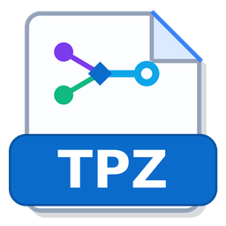

<p align="center">
  
</p>

<h1 align="center">TPZ Inspector</h1>

<p align="center">
  <strong>Offline SAP PI/PO <code>.tpz</code> Transport Analyzer, Visual Message Mapping Workbench, Offline Simulator &amp; Binary Repack Studio</strong>
</p>

<p align="center">
  
  
  
  
  
</p>

---

**TPZ Inspector** is a standalone, offline engineering workbench for inspecting, simulating, comparing, documenting, and safely repacking SAP Process Integration / Process Orchestration (SAP PI/PO) `.tpz` transport archives — without requiring a live SAP NetWeaver system or Swing ESR/ID client.

Built for offline interoperability and migration analysis, it reads both **Enterprise Services Repository (ESR)** and **Integration Directory (ID)** transport archives (`.tpt` and `.dlt`), including multi-megabyte standard and custom software component exports.

---

## Dual-Engine Architecture

TPZ Inspector runs in two seamlessly switchable modes directly from the UI:

| Capability | 100% Browser Mode (Zero-Upload) | Local Power Engine (Python + JDK + CFR) |
|---|---|---|
| **Data Residency** | Stays strictly inside browser memory | Stays strictly on `127.0.0.1:8765` |
| **Dependencies** | None (static bundle) | Python 3.10+ (zero `pip` deps required for standalone server) |
| **`.tpt` & `.dlt` Parsing + CRC32 Verification** | Supported (`fflate` + TS codec) | Supported (streaming Python codec) |
| **Visual Mapping Graph, Spec Table & XSD Resolver** | Full support | Full support |
| **Offline Mapping Simulator & Display Queue** | ~45 standard SAP ESR functions | Standard functions + **real local JVM (`javac`/`java`) Java UDF execution** |
| **Java `.class` / JAR Inspection** | Client-side JVM constant-pool & signatures | Full **CFR 0.152 `.java` decompilation** + **`javap -p -c`** bytecode |
| **Binary `.tpz` Repack & Sanitizer Studio** | — | Channel attribute patching, 1-click PII/credential sanitizer, CRC32 rebuild |
| **Local Disk Folder & File-Association Launch** | File picker / Drag & Drop | Direct disk path / folder scan + Windows `.tpz` double-click launch |

---

## Key Features

### 1. 5-Mode Message Mapping Workbench (`XI_TRAFO`)
Supports both modern `<brick type="Dst">` (XI 7.1 / PO 7.5) and legacy `<mapping destPath="...">` schemas:
- **ESR Split View:** Side-by-side Source & Target XSD trees, Expand/Collapse All, mapping-kind badges, and an `xsd:choice`-aware **Missing Mandatory (`1..n`) Field Detector**.
- **Interactive Data-Flow Graph (`@xyflow/react` + `@dagrejs/dagre`):** Pan/zoom lineage graph with Target-Field isolation, Overview mode, MiniMap, Fullscreen, and a slide-over Node Inspector displaying full XPaths, function parameters, and embedded UDF Java code.
- **Field Mappings Spec Table:** Searchable/filterable flat specification with one-click **CSV** and **Excel** export.
- **Source-to-Target Impact Matrix:** Instant visibility into which target fields depend on any source node, constant, or UDF.
- **Offline Message Mapping Simulator & SAP Display Queue:**
  - Auto-generates sample Source XML from the resolved XSD schema.
  - Evaluates ~45 standard SAP ESR functions (`concat`, `substring`, `ifWithoutElse`, `mapWithDefault`, `removeContexts`, `collapseContexts`, `splitByValue`, `useOneAsMany`, `formatByExample`, `createIf`, `exists`, `FixValues`, `sortByKey`, date/math/boolean functions, and more).
  - SAP **Display Queue** visualization supporting documented `ResultList` markers (`SUPPRESS`, `CC`, `XSI_NIL`).
  - **Real Local JVM Java UDF Execution:** Compiles and executes embedded Java UDFs (`value`, `context`, and `queue` cache types) locally via `javac` + `java` against lightweight clean-room interoperability stubs, capturing `MappingTrace` logs alongside the generated Target XML.

### 2. ICO Flow & SAP CPI Migration Analyzer (`AllInOne`, `Channel`, `MAPPING`)
- Renders end-to-end **Integrated Configuration (ICO)** pipelines: Sender Channel → Inbound Interface → Routing Rules → Operation Mapping(s) (`REQUEST_TRAFO` / `RESPONSE_TRAFO` / `FAULT_TRAFO`) → Receiver Interface(s) → Receiver Channel(s).
- Parses both referenced `Conditions/RDS_CONDSHORT` and inline `InterfaceDetermination/Condition/RDS_CONDSHORT` routing blocks into **SAP Cloud Integration (CPI) Router XPath** expressions.
- Highlights Adapter Types, Adapter Module Chains, Quality of Service (`EO`, `EOIO`, `BE`), masked credentials (with Reveal/Hide), and CPI migration complexity estimates.

### 3. Binary `.tpt` / `.dlt` Codec, CRC32 Verifier & Repack Studio
- Verifies every `.tpt` and `.dlt` member in an archive:
  - Header XML CRC32 (`[8B length][4B zero][4B CRC32][XML]`).
  - 1-MiB (`1,048,576`-byte) logical body chunk markers (`[4B zero][4B CRC32]`).
  - Single-block catalog modes (`stream_crc` and `cat_crc`) and **multi-block catalog continuation framing** for large archives (> 1 MiB catalogs).
  - Binary `pvcElement`, `pvcVersionSet`, `pvcVersionSetSpecialization`, and `knownDevlines` metadata decoding to surface version badges, membership checks, and workspace cross-archive devline references.
- **Repack & Sanitizer Studio:**
  - Patch Communication Channel attributes (URLs, SOAP actions, usernames, hosts, timeouts) across environments (`DEV` → `QA` / `PROD`).
  - One-click **Archive Sanitizer** redacting credentials, private IPv4 addresses, internal hostnames, emails, and sensitive endpoints before sharing packages externally.
  - Recalculates all segment offsets, 1-MiB chunk boundaries, and CRC32 markers, then optionally reloads the rebuilt `.tpz` directly into the workspace for instant Diff verification.

### 4. Deep ESR & Directory Object Inspectors
- **Full ESR XSD / WSDL Schema Resolver:** Resolves `ifmmessage` → `ifmtypedef`, recursive `ifmtypedef → TYPE → ifmtypedef`, `ifmextdef` (`ifr://schema?keyelements=name|namespace`, relative filename + `targetNamespace` includes, embedded `textualResources`), `rfc`, and `idoc` structures with full QName and `targetNamespace` awareness.
- **UDF Lab & Java Mapping Inspector:** Side-by-side **SAP PO Java UDF → SAP CPI Groovy** starter generator, clickable *"Used in target fields"* cross-references, and a 3-way `.class` viewer (**CFR `.java`** | **`javap -p -c`** | **JVM Inspector**).
- **Noise-Free DEV vs. QA/PROD Diff:** Compares loaded `.tpz` archives across mappings, UDF Java code, channels, and links while masking export-specific `container@key` attributes on Operation Mappings to avoid false-positive XML diffs.
- **Multi-Archive Workbench:** VS Code-style open tabs, Back/Forward navigation (`Alt+←` / `Alt+→`), Pinned objects, Cross-Archive Lineage & Impact Search, Excel Spec Export, **ccBPM** visual process timelines, multilingual `DOCU` viewer, Light/Dark themes, and **English / Turkish** UI toggle.

---

## Quick Start

### Prerequisites
- **Python 3.10+** (required for Local Power Engine; zero external `pip` packages needed when using `standalone_server.py`)
- **Node.js 20+** & **npm** (to build the React frontend bundle)
- **JDK 11+** (`java`, `javac`, `javap` on `PATH` or `JAVA_HOME`) — optional, enables CFR `.java` decompilation, bytecode disassembly, and local JVM UDF simulation.
- `tools/cfr-0.152.jar` is bundled under the MIT License (see [THIRD_PARTY_NOTICES.md](THIRD_PARTY_NOTICES.md)) and auto-detected (or override via `CFR_JAR`).

### 1. Clone & Build the Frontend

```bash
git clone https://github.com/haliltalhaertan/TPZ-Inspector.git
cd TPZ-Inspector

cd web
npm install
npm run build
cd ..
```

### 2. Run TPZ Inspector

**Windows:**
```bat
start.bat
```
Or pass `.tpz` file(s) / folders directly:
```bat
start.bat C:\exports\my_package.tpz
```

**Linux / macOS:**
```bash
chmod +x start.sh
./start.sh
```

The standalone server starts at **`http://127.0.0.1:8765`** and opens your browser automatically.

### Development Mode (Hot Reload)

Run the Python backend and Vite dev server side by side:

```bash
# Terminal 1 — Backend (http://127.0.0.1:8765)
python3 backend/standalone_server.py --no-browser

# Terminal 2 — Frontend (http://127.0.0.1:5173, proxies /api to :8765)
cd web
npm run dev
```

> **Optional FastAPI Server:** If you prefer FastAPI + Uvicorn over the zero-dependency stdlib server, install `pip install -r backend/requirements.txt` and run `uvicorn app:app --app-dir backend --host 127.0.0.1 --port 8765`.

---

## Windows Native Shell Integration

On Windows, TPZ Inspector includes helper scripts for a native desktop experience (per-user `HKCU` registry — no administrator privileges required):

| Script | Action |
|---|---|
| `KURULUM.bat` | One-click per-user installer: checks/installs Python 3, installs files to `%LOCALAPPDATA%\TPZ-Inspector`, registers `.tpz` icon & double-click association, enables silent background auto-start, and creates a Desktop shortcut. |
| `KALDIR.bat` | One-click uninstaller removing the background service, Startup & Desktop shortcuts, `.tpz` registry keys, and `%LOCALAPPDATA%\TPZ-Inspector`. |
| `register_tpz_filetype.bat` | Registers the custom `.tpz` icon (`assets/tpz_file.ico`), associates double-click on `.tpz` files to open directly in TPZ Inspector, and adds a folder right-click context menu. |
| `unregister_tpz_filetype.bat` | Cleanly removes all `.tpz` file-type and folder context-menu registry keys. |
| `autostart_enable.bat` | Installs a silent `pythonw.exe` background server shortcut in Windows Startup so double-clicking any `.tpz` opens instantaneously. |
| `autostart_disable.bat` | Removes the Startup shortcut and stops the background server. |

---

## Running Unit Tests

All backend unit tests are 100% self-contained (synthetic in-memory `.tpz` fixtures, zero external archive dependencies):

```bash
python3 -m unittest discover -s backend/tests -v
```

Test suites included:
- `backend/tests/test_tpt_codec.py` — Single-block channel patching, >1 MiB multi-chunk sanitization & boundary shifting, `stream_crc` + `cat_crc` bit-exact roundtrip, HTTP `/verify` & `/repack` endpoints, 35,000-segment multi-block catalog roundtrip & length-changing repack, VersionSet UUID chain / `pvcVersionSet` / `pvcVersionSetSpecialization` / `knownDevlines` parsing, and cross-archive workspace devline lookup.
- `backend/tests/test_engine.py` — Depth-aware `<p1:xiObj>` stream repair, modern brick & legacy `destPath` mapping parsers, ICO/Channel positional key extraction, and full HTTP upload/inspect/search/delete lifecycle.
- `backend/tests/test_mapping_simulator.py` — Standard SAP ESR functions, `ResultList.SUPPRESS` / `CC` queue evaluation, `MappingTrace` capture, and real local JVM compilation/execution of `value` and `context` Java UDFs.

---

## Project Structure

```text
TPZ-Inspector/
├── assets/
│   ├── tpz_file.ico                      # Multi-resolution (16–256px) Windows .tpz icon
│   └── tpz_file_256.png                  # Application icon
├── backend/
│   ├── standalone_server.py              # Zero-dependency HTTP server + API + static UI host
│   ├── app.py                            # Optional FastAPI ASGI entrypoint
│   ├── engine.py                         # TPZ parser, ESR/ID extractor, CFR/javap decompiler
│   ├── tpt_codec.py                      # Binary .tpt/.dlt 1-MiB CRC32 verifier, PVC decoder & repacker
│   ├── mapping_simulator.py              # Offline Message Mapping evaluator & JVM Java UDF runner
│   ├── open_tpz.py                       # Silent Windows file-association launcher
│   ├── requirements.txt                  # Optional FastAPI/Uvicorn dependencies
│   └── tests/                            # Self-contained unittest suite (13 tests)
├── tools/
│   └── cfr-0.152.jar                     # Bundled CFR Java decompiler (MIT License)
├── web/
│   ├── public/favicon.ico
│   └── src/
│       ├── App.tsx                       # Workbench shell, tabs, history, drag-and-drop
│       ├── styles.css                    # Light/Dark editorial design system
│       ├── core/
│       │   ├── tpzBrowserParser.ts       # 100% browser-side .tpz/.tpt/.dlt parser & CRC32 verifier
│       │   ├── browserMappingSimulator.ts # Client-side Message Mapping queue simulator
│       │   ├── jvmClassInspector.ts      # Client-side JVM .class constant-pool & signature reader
│       │   ├── engines.ts                # Unified Browser / Local API engine abstraction
│       │   ├── excelExport.ts            # Multi-sheet Excel specification exporter
│       │   └── types.ts                  # Shared TypeScript domain contracts
│       ├── i18n/translations.ts          # English & Turkish localization
│       └── ui/
│           ├── DashboardView.tsx         # Executive KPIs, CPI readiness, inventory & global search
│           ├── MappingView.tsx           # 5-mode Message Mapping workbench
│           ├── MappingGraphCanvas.tsx    # Interactive ReactFlow + Dagre lineage graph
│           ├── MappingSimulatorView.tsx  # Offline Simulator & SAP Display Queue UI
│           ├── FlowView.tsx              # ICO pipeline & CPI iFlow router blueprint
│           ├── ObjectView.tsx            # UDF Lab, Channel, Java Class, ccBPM & DOCU inspectors
│           ├── SchemaTreeView.tsx        # Source/Target XSD tree & missing mandatory detector
│           ├── structure.ts              # Full ESR XSD/WSDL/RFC/IDoc schema resolver
│           ├── RepackStudioModal.tsx     # Binary channel patcher & archive sanitizer studio
│           ├── CodeViewer.tsx            # Syntax-highlighted Java/Groovy/XML/javap code viewer
│           ├── Panels.tsx                # Diff modal, Disk Path loader, Engine switcher
│           └── links.ts / strings.ts     # Cross-object link resolver & UI formatting helpers
├── KURULUM.bat / KALDIR.bat              # 1-click Windows per-user installer & uninstaller
├── start.bat / start.sh                  # Cross-platform launchers
├── register_tpz_filetype.bat             # Windows .tpz icon & shell registration
├── autostart_enable.bat                  # Windows silent background autostart
├── LICENSE                               # MIT License
└── THIRD_PARTY_NOTICES.md                # Third-party open-source attributions
```

---

## Container Format & Interoperability Notes

- **`.tpt` / `.dlt` 1-MiB Chunk Framing:**
  Logical streams before `<catalog>` are split into `1,048,576`-byte (1 MiB) blocks, each followed by an 8-byte CRC32 frame marker `[00 00 00 00][uint32 BE CRC32]`, seeded with `0` for block 0 and `0xDC358A91` for subsequent blocks.
  The final 8 bytes store the big-endian `uint64` logical length before `<catalog>`. Both single-block CRC modes (`stream_crc` and `cat_crc`, always verified directly on the inner bytes) and multi-block catalog continuation framing (> 1 MiB catalogs) are supported.
- **Header Checksum & Version Metadata:**
  Header records use `[8B length][4B zero][4B CRC32][header XML]`. When present, `header/versionSet@id` (network byte order) is cross-checked against `pvcVersionSet`, `pvcVersionSetSpecialization`, and `pvcElement` metadata; `knownDevlines` resolves member-local and cross-archive `ownerVSID` (`R3`) references cleanly while surfacing unexported external references neutrally.
- **Noise-Free `TPZ Diff`:**
  Masks export-specific `<container key="...">` attributes before fallback XML comparison on Operation Mappings so identical objects across separate exports are not falsely flagged as modified.
- **External XSD Resolution:**
  Resolves both `ifr://schema?keyelements=name|namespace` references and relative `ifmextdef` `xs:include` / `xs:import` paths using case-insensitive filename + `targetNamespace` disambiguation.

---

## Security, Privacy, License & Disclaimer

- **100% Offline & Local:** TPZ Inspector makes zero outbound network requests and contains zero telemetry. All archives stay in your browser or on `127.0.0.1`.
- **Never commit real `.tpz` files:** `.gitignore` excludes `*.tpz`, `*.tpt`, and `*.dlt` by default.
- **License:** Released under the [MIT License](LICENSE). Third-party notices (including CFR 0.152) are listed in [THIRD_PARTY_NOTICES.md](THIRD_PARTY_NOTICES.md).
- **Disclaimer:** TPZ Inspector is an independent open-source community tool and is not affiliated with, endorsed by, or sponsored by SAP SE. SAP, SAP PI, SAP PO, SAP NetWeaver, and SAP Cloud Integration are trademarks of SAP SE.
